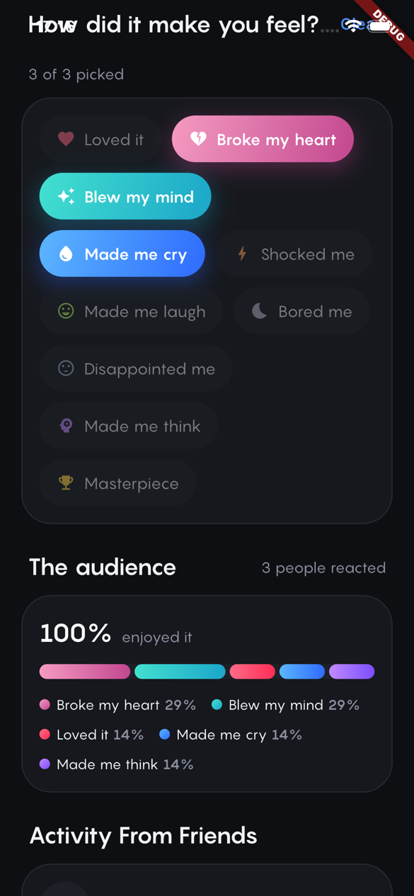
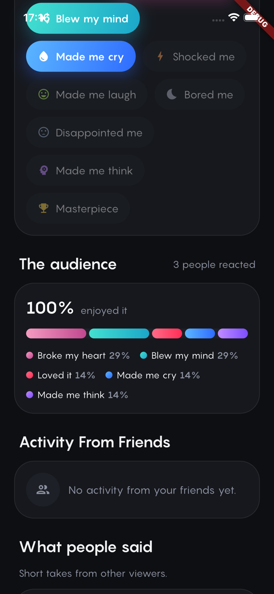
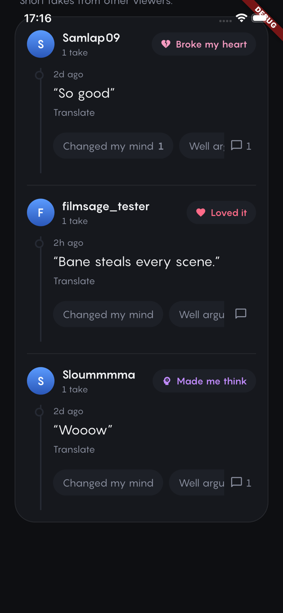
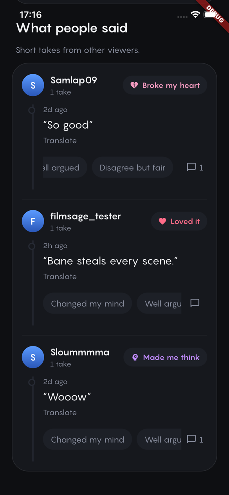

# Film page: feelings, audience and "What people said"

Issue: #14. Screen: `lib/features/find/views/film_detail_screen.dart` (Overview tab).
Screenshots: iPhone 16e simulator, iOS 26.3, signed in, against the local backend.

## Section pattern

Every overview section uses one layout: the title sits outside the card (22 pt, semibold)
with an optional link or note on the right, an optional grey hint under it, then a dark
card (`LuxeColors.surface`, 28 px radius, hairline border) that fills the width. The page
content is capped at `AppTokens.maxContentWidth` (640) and centred, so it fills phones and
stays readable on tablets. No widget has a fixed width; chips wrap and the vote row
scrolls sideways, so nothing overflows on small phones.

## How did it make you feel?

- Every feeling is a chip right in the card (`FeelingPicker`, `FeelingChip` in
  `film_reviews/presentation/widgets/feeling_chip.dart`). No bottom sheet.
- Each feeling has its own colour (`reactionColors` / `reactionGradient` in
  `reaction_labels.dart`). A picked chip fills with that gradient and glows; unpicked chips
  stay matte with the colour on the icon.

  | Feeling | Gradient |
  |---|---|
  | Loved it | `#FF6B88` → `#FF2D55` |
  | Broke my heart | `#F59BC1` → `#C2478F` |
  | Made me cry | `#5BB6FF` → `#2F6BFF` |
  | Blew my mind | `#43E0D0` → `#1BA6C9` |
  | Made me think | `#C08BFF` → `#7C4DFF` |
  | Masterpiece | `#FFD54A` → `#E8A100` |
  | Shocked me | `#FFA45B` → `#F2600C` |
  | Made me laugh | `#B5F06A` → `#4CB944` |
  | Bored me | `#B4B8C8` → `#6E7387` |
  | Disappointed me | `#9DB4CC` → `#4F6A85` |

- Up to 3 feelings (backend migration `0009 film_reactions_up_to_three`). At the limit the
  other chips fade; tapping a picked chip removes it. The hint reads "Pick up to 3
  feelings." or "N of 3 picked", and "Clear" appears on the right once something is picked.
- Taps save straight away through `MovieReviewsCubit.setFeelings` (`PUT
  /api/takes/films/<id>/reaction/`). Saves run one at a time; taps made during a save are
  sent together after it. A failed save rolls back and shows a snackbar.

## The audience

- The header shows "N people reacted".
- `AudienceBar` draws one static bar: a segment per feeling, in its gradient, sized by its
  share, largest first, with a legend of colour dot, name and percentage underneath.
- Shares come from the summary's full `counts` map (`MovieReviewSummary.allCounts`).
  `most_felt` is capped at three by the backend, so it is only the fallback.
- Percentages are of feelings, not people: one person can pick three feelings.
- The "N% enjoyed it" line stays above the bar when the backend sends `everyone_percent`.

## Activity from friends

Same section pattern. `FriendActivity(embedded: true)` drops its own title and card; the
empty state is a people icon beside "No activity from your friends yet."

## What people said

`PeopleTakes` (`film_reviews/presentation/widgets/people_takes.dart`):

- Takes are grouped per person, in the order people first appear in the server list.
- Person header: avatar initial on the blue gradient, name, "N takes", and a pill with
  their feeling in its own colour (up to half the row wide).
- Each person's takes sit on a vertical thread with dots. The most helpful take (not your
  own) gets a filled blue dot and a "TOP TAKE" label.
- A take shows its relative time, the quote in large text, a Translate link
  (`TranslatableText`, muted link style), any photo, then a row of vote chips ("Changed my
  mind", "Well argued", "Disagree but fair") with counts. The row scrolls sideways. The
  comment button on the right shows the count and opens the take page with comments.
- Voting is disabled on your own takes; a failed vote shows a snackbar.
- Two takes show per person; "Show N more takes" reveals the rest and "Show less" folds
  them back.
- Holding a take still summons the angel bird to start a debate.
- "Add take" (right of the title) and the full-width gradient "Share your take" button both
  open a sheet with a 280-character field. Both disappear once you have posted your review
  (one review per person). This replaces the old inline "Your take" box.

## Strings

New ARB keys (en, fr, ar, ru): `filmTakeCount`, `filmTopTake`, `filmShowMoreTakes`,
`filmShowLessTakes`, `filmShareYourTake`, `filmAddTake`.

## Tests

- `test/features/find/film_detail_screen_test.dart`: inline feeling chips (limit of three,
  removing one), the audience bar, sharing a take through the sheet.
- `test/features/film_reviews/people_takes_test.dart`: grouping per person, TOP TAKE,
  "Show more" / "Show less", parsing the full `counts`.

## Not yet checked on a device

- The "Share your take" sheet and the "Show more" toggle (the test account already had a
  review and nobody had more than two takes). Widget tests cover both.
- Tablet widths.
